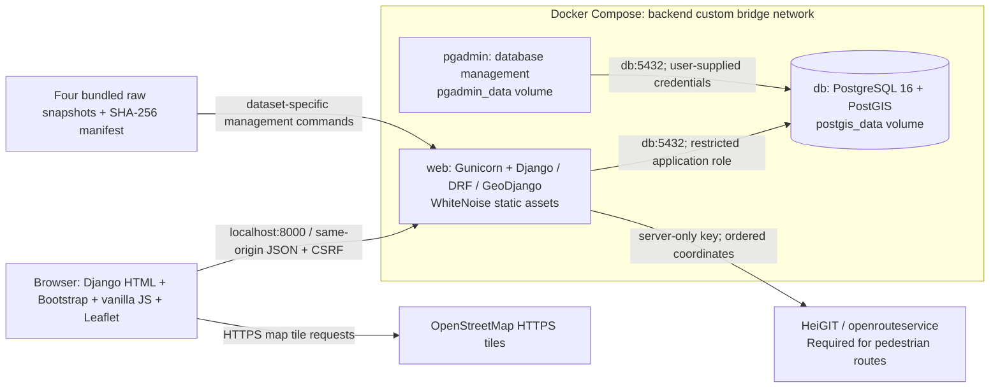

# DublinQuest architecture

DublinQuest is one conventional Django project with two apps: `places` owns the imported attractions, park boundaries, staff CRUD and spatial searches; `adventures` owns selection, saved quests and guest progress. Django's model/template/view structure fulfils the brief's MVC separation: models store data, views coordinate requests, and templates plus JavaScript provide presentation.

The three Docker services are **`web`** (Django and static files), **`db`** (PostgreSQL/PostGIS) and **`pgadmin`** (database management). All share the custom **`backend`** bridge network, with default subnet **172.28.40.0/24** configured through `DOCKER_SUBNET`. Only web and pgAdmin publish ports, both on `127.0.0.1`. Database and pgAdmin data survive container replacement through named volumes. No frontend build system, separate API server, task queue or locally hosted routing engine is required. A valid server-side ORS key is required for the intended pedestrian routes and walking distance/time estimates. With ORS unconfigured or unavailable, core quests/progress remain usable through straight-line fallback, which does not follow walkable streets or provide walking estimates. Map tiles require internet access.

## Request and data flow

1. The template loads local Bootstrap/Leaflet assets and `static/js/explore.js`. `/api/session/` establishes the database-backed guest session and returns a CSRF token.
2. Autocomplete calls the imported-place API. Three attributed starting shortcuts or a map click select coordinates without creating a Place or calling a geocoder.
3. Generating a quest posts start/categories/radius/count. DRF validates inputs, GeoDjango transforms `[longitude, latitude]` from EPSG:4326 to EPSG:2157, and an indexed PostGIS proximity search finds candidates.
4. `adventures/generation.py` reserves category representatives, fills remaining nearest candidates and applies deterministic greedy nearest-next ordering. It excludes coincident stops; it does not optimize walking distances. The transaction saves ordered stops, a PostGIS buffer and a straight-line LineString.
5. Serializers transform copies to 4326 GeoJSON. Leaflet displays numbered markers, the search Polygon and sequence. Journey cards use the same API data, without reproducing spatial selection in JavaScript.
6. After quest rendering, an automatic, CSRF-protected owner-only POST requests a pedestrian overlay; a valid ORS key is required for success. Django validates a single ORS response, including geometry, summaries, waypoint indices and snapping tolerance. It never changes saved geometry or moves attraction markers.
7. The browser caches in-flight/success/failure routing results by quest geometry and stops for that page lifetime. Switching views or updating visits reuses them. Regeneration invalidates them. ORS `way_points` split the actual returned geometry into incoming legs; completed destinations grey their own leg. Equal indices produce no invented line.
8. Visit updates are transactions on the session-owned quest. Map popups and journey checkboxes share one mutation function. Markers, progress, next discovery and route colours update only after the server accepts the change. Completion is self-reported.

## Security and limits

Every guest object lookup is filtered by the owner UUID held in the server-side session, including routing. Anonymous unsafe requests explicitly enforce CSRF. Staff spatial CRUD uses session authentication, staff permissions, geometry validation and atomic updates; park edits synchronize their representative Place. Protected references prevent deleting attractions used by quests. Staff CRUD is provided by the authenticated DRF browsable interface, not custom Django-admin model screens.

Input geometry is strict 2D GeoJSON; source attribution and owner fields are not client-writable. SQL buffer arguments are parameterized. ORM filtering, escaped text/DOM construction, bounded parameters, no-store quest responses and same-origin requests reduce common injection/data-leak risks. ORS responses are whitelisted; upstream error bodies and credentials are not relayed or logged by the routing helper.

This is a loopback HTTP deployment, not a public HTTPS production service. `DEBUG=False`, non-root Gunicorn, explicit hosts, password validation, restricted database role and private secrets are configured. Four HTTPS-related Django deployment warnings remain intentional for local HTTP; TLS, HSTS and secure-cookie deployment require a properly configured HTTPS endpoint. Formal security, WCAG compliance and load testing have not been assessed.

## Relationship to the module

GeoDjango models/migrations, projected spatial queries, management-command loading, DRF serializers/views/URLs, Leaflet/GeoJSON and Compose/PostGIS/pgAdmin follow the course patterns. See [DATABASE_SCHEMA.md](DATABASE_SCHEMA.md) and [API.md](API.md) for implementation details. Database-backed guest ownership, explicit anonymous CSRF enforcement and idempotent import ledgers complete the application's requirements. WhiteNoise and the ORS pedestrian overlay are small additions beyond the core lab setup; neither replaces the taught spatial database work.
