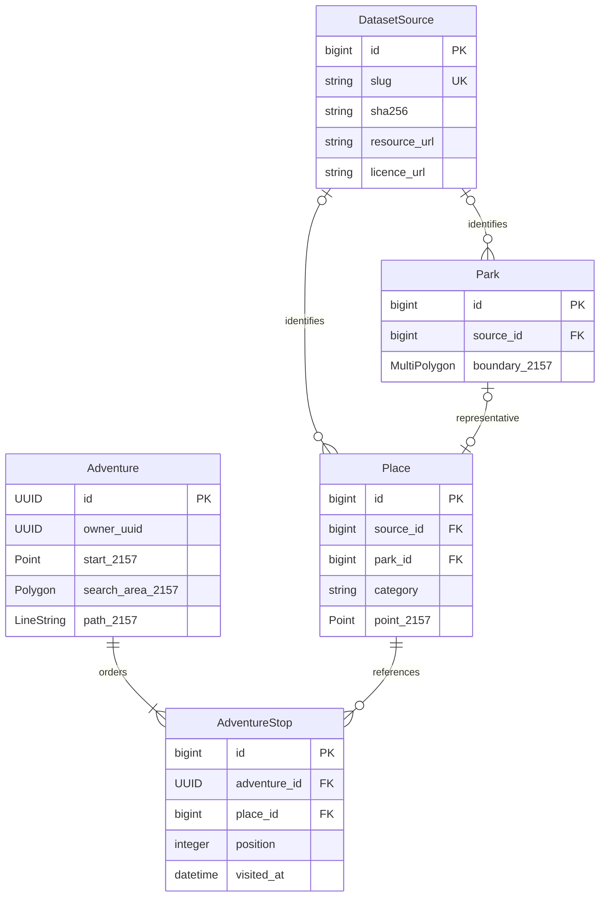

# Database schema

The schema is implemented in `places/models.py` and `adventures/models.py`, with committed migrations. Spatial data is stored in PostGIS, not SQLite. The four dataset-specific management commands populate this schema from the bundled snapshots; see README and DATA_SOURCES.md for commands and audit counts.



The diagram shows successful generated adventures; the schema also allows an ungenerated Adventure with no stops and nullable path/search area. Session ownership is an application-level link through the UUID in Django's `django_session` data, not a foreign key to `auth_user`.

## Spatial entities and provenance

| Model | Main fields | Relationships and constraints |
|---|---|---|
| DatasetSource | Unique slug, title, publisher, resource URL, licence name/URL, attribution, snapshot filename, SHA-256 | Referenced source records protect their provenance from deletion |
| Park | Name, typology, MultiPolygon boundary, active flag, timestamps | Optional source FK (imported records retain provenance); unique `(source, source_key)` |
| Place | Name, description, category, Point, artist, profile URL, active flag, timestamps | Optional source FK (imported records retain provenance); unique `(source, source_key)`; optional one-to-one Park |
| Adventure | UUID primary key, guest owner UUID, title, start Point, radius, category list, requested stop count, search Polygon, sequence LineString, timestamps | Indexed owner UUID; radius 250–5000 metres; requested count 1–10 |
| AdventureStop | Position, distance from start/previous stop in metres, visited timestamp | Adventure FK, Place FK; unique position and unique place per adventure; positive position and nonnegative distances |

All five geometry columns use EPSG:2157 and have GeoDjango spatial indexes (PostGIS GiST). Place category has a normal B-tree index; relationship and uniqueness indexes are generated by Django. No duplicate manual spatial indexes are added.

A park's optional representative Place must have category `park`; other categories cannot link to a Park. Deleting a Park cascades to its representative Place, but a Place used by an AdventureStop is protected. Deleting an Adventure removes its stops while retaining the attractions. There are no duplicated latitude/longitude columns.

`source_key` is the importer's stable identifier within a dataset; source titles, artwork names and coordinates are not globally unique. The park importer uses the qualified `PRIMARYINDEX`. The point-source commands use one-based `row:<number>` keys within their checksum-pinned snapshot, rather than treating duplicated artwork profile links as unique keys. Changing snapshots requires a reviewed identifier/reconciliation decision.

The guest owner UUID is a server-assigned session identifier, not a user-supplied ownership claim. The guest request handler supplies the session's owner identifier. Guest endpoints filter every lookup by the owner UUID in the server-side database session; see API.md. That UUID is not accepted from API input or exposed in responses.

## Coordinates and generated geometry

Source GeoJSON declares CRS84 (WGS84 longitude/latitude). Load GEOS points as `(longitude, latitude)`, assign the source SRID, then call `transform(2157)` before validation/save. Browser GeoJSON is transformed back to EPSG:4326 by the serializers. The public-art CSV datum remains an explicitly documented qualification uncertainty; the CSV command requires an explicit `--source-srid 4326` declaration and records the remaining datum uncertainty.

Geometry validators reject empty/invalid geometry and require EPSG:2157. Django `save()` does not automatically call `full_clean()`: importers and mutation paths explicitly validate. PostgreSQL geometry typmods enforce stored type/SRID, while uniqueness and scalar checks provide separate database safeguards. Model validation is not a claim that raw SQL automatically enforces GEOS validity.

Adventure search area and path remain nullable at schema level for ungenerated records, but successful guest API creation always fills both. The generation function builds a valid EPSG:2157 LineString from the start and ordered stops and a PostGIS search buffer. Regeneration replaces geometry and stops atomically while preserving the adventure UUID/owner; visited progress resets after confirmation. Renaming does not regenerate. Stop order/distances describe generation time; regenerate if staff later move related source places. These lines are straight connections, not pedestrian routes. The park importer explicitly synchronizes each representative point to the transformed boundary's point-on-surface; no synchronization is hidden inside model `save()`. The staff parks API uses the same explicit synchronization rule.

## Migrations and tests

Apply schema changes using the restricted application account:

```bash
docker compose build web
docker compose run --rm web python manage.py migrate --noinput
docker compose up -d --wait web
```

Database-backed tests use a separate `test_<POSTGRES_DB>` database. Provision it once as the database administrator, installing PostGIS there, without granting the runtime role superuser or CREATEDB:

```bash
docker compose exec -T db sh -c 'psql -v ON_ERROR_STOP=1 -U "$POSTGRES_USER" -d "$POSTGRES_DB"' < scripts/create_test_database.sql
docker compose run --rm web python manage.py test places adventures config --keepdb
docker compose run --rm web python manage.py makemigrations --check --dry-run
```

The SQL script creates only the named test database if missing; it does not reset the application database. `--keepdb` reuses the prepared test database so Django does not need database-creation privileges. Never point the test database name at the application database.

Verified against Docker/PostGIS: initial migrations apply from an empty test schema; coordinate round trips preserve longitude/latitude; Point, Polygon and LineString values round-trip; all five spatial indexes exist; source/stop uniqueness and radius constraints reject invalid writes; used places resist deletion; deleting adventures removes their stops. Model/API tests use clearly synthetic fixtures and roll back their records. Migration `places.0002` permits null provenance on staff-created records instead of falsely assigning an external dataset publisher. API clients cannot change source links or keys; imported records and their four DatasetSources remain unchanged.
