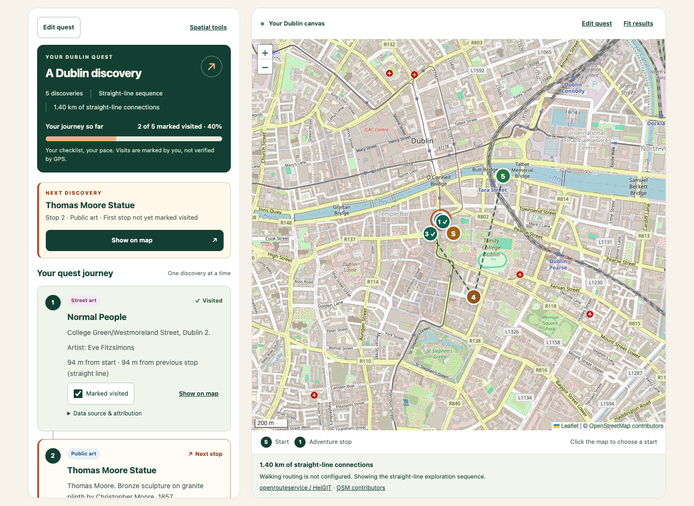
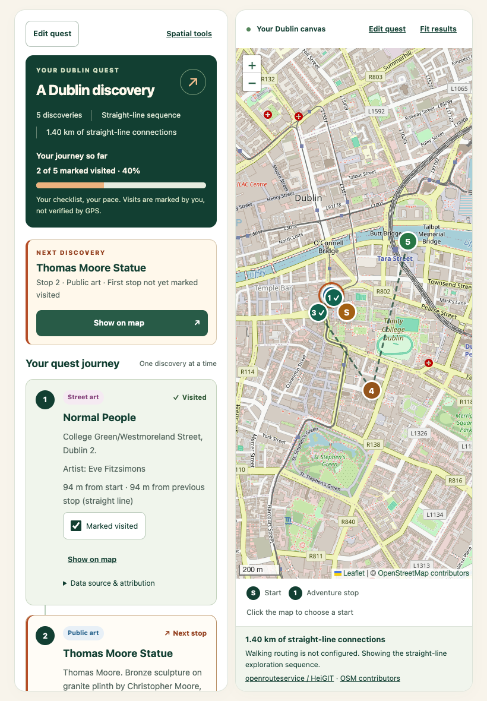
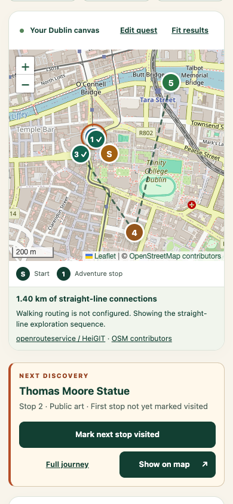

# DublinQuest

### Explore Dublin Your Way

DublinQuest is a location-based exploration app I'm developing for CMPU4058 — Advanced Web Mapping at TU Dublin. The idea is to help people discover Dublin through its street art, historic landmarks, public artworks and parks.

Instead of following a fixed tour, you choose where to start, what interests you, how far to explore and how many places to visit. DublinQuest uses those choices to put together an adventure on an interactive map.

## How it works

1. Choose an imported place suggestion, a popular starting-point shortcut, or click the map.
2. Select your interests, a search radius and the number of stops.
3. Explore the suggested stops using the map and an ordered list of places.
4. Follow your quest journey, mark stops as visited and keep track of your progress.

Visited markers show an emerald checkmark; the next marker has an orange ring and arrow. Marker popups also let you mark or undo a visit. Incoming walking-route legs have distinct colours and turn grey when their destination is marked visited, without another routing request. Expand **Leg colours** in the journey for numbered labels. Shared mapped sections can overlap visually.

The next discovery is the first stop you have not marked visited. Journey cards and numbered map markers
distinguish Next stop, Upcoming and Visited; completing the checklist reveals a
Quest complete panel. Progress is self-reported, not verified by GPS.

After generation, the journey replaces the builder beside the map on desktop and
scrolls independently. On mobile, a compact next-stop panel provides visit/undo
actions beneath the map and opens the full journey when needed. **Edit quest**
returns to the existing builder; apply edits with regeneration, or return to the
saved quest without applying them.

The map shows the starting point, search area, numbered stops and a suggested sequence connecting them. Each stop includes a description, category and distance information.

The dashed connecting lines show the suggested exploration order and straight-line distances. An estimated pedestrian route from openrouteservice/HeiGIT loads automatically when available; it leaves the original sequence and stop order unchanged. A simple control switches between walking and straight-line views. Walking times exclude visits, and entrances/current access are not verified.

## Web mapping

The project uses real Dublin open data stored in PostgreSQL/PostGIS. Its spatial features include:

- Finding places within a chosen radius.
- Finding attractions inside a park's boundary.
- Finding parks and open spaces that overlap the search area.
- Storing places as points, park boundaries as polygons and adventure sequences as lines.
- Creating, viewing, editing and deleting spatial records through the authenticated DRF browsable API.

Adventures and visited stops are saved for the same browser, without requiring a visitor account.

## Technology stack

- **Backend:** Python, Django, GeoDjango and Django REST Framework
- **Database:** PostgreSQL with PostGIS
- **Map:** Leaflet.js and OpenStreetMap
- **Frontend:** HTML, CSS, JavaScript and Bootstrap 5
- **Local deployment:** Docker Compose and pgAdmin

## Scope

The initial version focuses on spatial searches, interactive mapping and a complete exploration flow. It won't include live GPS tracking, turn-by-turn navigation or an AI assistant.

The application includes an interactive Leaflet map, adventure builder, saved guest adventures and visited-stop progress. The three spatial searches can also be used independently through the interface.

## Running locally

Docker Desktop with Docker Compose is required. No host Python, PostgreSQL or GIS installation is needed.

```bash
cp .env.example .env
```

Edit `.env` and replace all `change-me` values with different random passwords and a long Django secret key. `openssl rand -hex 32` can generate each value. Keep `.env` private. The database administrator and application use separate accounts; keep their usernames different.

```bash
docker compose config --quiet
docker compose build web
docker compose up -d --wait db
docker compose run --rm web python manage.py migrate --noinput
docker compose up -d --wait
docker compose exec web python manage.py createsuperuser
```

- DublinQuest: http://localhost:8000/
- Readiness: http://localhost:8000/health/
- Django administration: http://localhost:8000/admin/
- pgAdmin: http://localhost:5050/ — sign in with the pgAdmin credentials in `.env`.

In pgAdmin, register a server with host `db`, port `5432`, maintenance database matching `POSTGRES_DB`, and the `DATABASE_USER` / `DATABASE_PASSWORD` application credentials. Use the administrator credentials only for database administration. Django staff accounts are separate from both database and pgAdmin accounts.

`/health/` checks database connectivity and PostGIS availability; it returns JSON with HTTP 200 when ready or 503 when unavailable. It does not certify that migrations have been applied.

## Project structure

- `config/`: settings, root URLs, page view, WSGI and readiness checks.
- `places/`: attractions, park data, imports and spatial APIs.
- `adventures/`: adventure selection, guest ownership, persistence and progress.
- `docker/db/`: first-run SQL that creates a restricted application database role.
- `templates/explore.html`: accessible adventure-builder page.
- `static/`: original CSS/JavaScript and licensed Leaflet/Bootstrap assets; collected output stays inside the web container.

The spatial schema is implemented in `places` and `adventures`; see [DATABASE_SCHEMA.md](DATABASE_SCHEMA.md) for fields, relationships, CRS handling and database-backed test commands. Migrations are applied explicitly during setup. Dataset import commands are available below; the places/parks endpoints and spatial searches are documented in [API.md](API.md). The frontend uses these same APIs; it does not repeat spatial queries or stop selection in JavaScript.

## Containers and persistence

The three services follow the module's Docker Compose structure. Django connects to `db:5432` over a custom bridge network, using subnet `172.28.40.0/24`. Change `DOCKER_SUBNET` before startup if it conflicts with another local network. Only web and pgAdmin ports are published, bound to the host's loopback address.

PostgreSQL and pgAdmin use named volumes. `docker compose down` keeps their data; **`docker compose down -v` deletes it**. Initialization credentials and the database-role SQL apply only to an empty database volume. Editing `.env` does not change passwords already stored in PostgreSQL or pgAdmin.

The web image runs as a non-root user with Gunicorn. WhiteNoise serves collected static assets without adding an Nginx service. It is a small addition to the labs' static-file setup. Source is copied into the image rather than bind-mounted, so rebuild after changing code, templates, static assets or dependencies:

```bash
docker compose up -d --build --wait
```

Migrations remain a separate explicit step after schema changes. Restarting containers does not reset or seed the database. Secrets and local course materials are excluded from both Git and the Docker build context.

### Apple Silicon

Verified on an Apple Silicon Mac with a `linux/arm64` Docker engine on 2 November 2026. The web image runs natively as ARM64; the PostGIS image runs with explicit `platform: linux/amd64` emulation. PostgreSQL 16.15 and PostGIS 3.6 started successfully, including initialization from an empty temporary database. Database connectivity, an EPSG:4326 → EPSG:2157 GeoDjango transformation and session persistence across container recreation passed.

The database uses `postgis/postgis:16-3.6`, a newer PostGIS version than the labs' 16-3.4 image. Emulation performance has not been benchmarked. Main Python dependencies are pinned in `requirements.txt`; container tags and transitive dependencies may still change on future rebuilds.

## Checks and troubleshooting

```bash
docker compose ps
docker compose logs --tail=100 web db
docker compose exec web python manage.py check
docker compose exec web python manage.py check --deploy
docker compose exec web python manage.py makemigrations --check --dry-run
docker compose exec web python manage.py test config
docker compose exec web python -m pip check
```

To inspect PostGIS:

```bash
docker compose exec db sh -c 'psql -U "$POSTGRES_USER" -d "$POSTGRES_DB" -c "SELECT PostGIS_Version();"'
```

If a port is occupied, stop the conflicting application or change the published host port in Compose. If database login fails, check the original credentials used to initialize the existing volume. Do not delete volumes as a routine fix. If an interrupted first startup leaves initialization incomplete, inspect the logs before repairing the database.

This setup uses `DEBUG=False`, explicit allowed hosts, CSRF middleware, password validators and restricted database credentials. It is intended for a local demonstration over HTTP. The deployment check reports four HTTPS-related warnings: HSTS, HTTPS redirection and secure session/CSRF cookies. Public hosting would require TLS and appropriate proxy/security configuration; it has not been configured or verified. Guest adventure mutations enforce CSRF protection and session ownership, including for anonymous visitors.

See [FRONTEND_TESTING.md](FRONTEND_TESTING.md) for the browser testing guide, responsive checks and optional automated browser test.

## Data sources

The repository includes four qualified, unmodified Dublin City Council dataset snapshots in `data/raw/` (3.27 MB total). They are third-party open data published under Creative Commons Attribution, separate from my original DublinQuest application code. See [DATA_SOURCES.md](DATA_SOURCES.md) for quality findings, attribution and reproduction commands, and [data/sources.json](data/sources.json) for exact resource URLs and SHA-256 checksums. A fresh clone includes the source files needed by the import commands, without a separate dataset download. The commands below populate PostGIS from those local snapshots. No dataset photographs are bundled. Small Leaflet library icons are included separately under their library licence; map tiles are loaded from OpenStreetMap at runtime.

## Populating the database

After the setup and migration steps above, run:

```bash
mkdir -p data/import-reports
docker compose run --rm -T web python manage.py import_canvas > data/import-reports/canvas.json
docker compose run --rm -T web python manage.py import_public_art --source-srid 4326 > data/import-reports/public_art.json
docker compose run --rm -T web python manage.py import_heritage > data/import-reports/heritage.json
docker compose run --rm -T web python manage.py import_parks > data/import-reports/parks.json
```

The CSV command explicitly declares WGS84 because its source metadata does not specify a datum; this interpretation is recorded in its report. The GeoJSON sources declare CRS84. All stored geometries are transformed to EPSG:2157. No external dataset downloads are needed.

Each command writes a JSON report containing counts and the outcome/reason for every source row. Reports are ignored by Git. The verified baseline is **314 Canvas places, 82 public artworks, 42 heritage places and 484 park boundaries with 484 representative places: 922 places overall**. See [DATA_SOURCES.md](DATA_SOURCES.md) for exclusions and quarantine reasons.

Re-running these commands updates the same source-keyed records rather than creating duplicates. It also restores their imported fields and park representative points, so run imports deliberately if staff have edited imported records. Commands verify the pinned snapshot checksums and run atomically per dataset; they do not erase the database, remove unrelated records, or download/repair source data. Do not update the source manifest to bypass a checksum error without qualifying the changed dataset first.


## Spatial API

Public GeoJSON endpoints provide place/park listings, category filters, proximity searches, park containment and buffered-area intersection. Spatial writes require an active staff account and session CSRF protection. See [API.md](API.md) for endpoints, example requests, expected Dublin results and manual CRUD tests. Interactive API documentation is available at http://localhost:8000/api/docs/.


## Your first adventure

Guest sessions can now generate/save adventures, retrieve them, mark stops visited, regenerate their straight-line sequence and delete them. No visitor account is needed. The algorithm selects real nearby places with category variety and a deterministic nearest-next order; it does not calculate walking routes. Open http://localhost:8000/, search for **Thomas Moore**, choose the result near College Green, leave the four categories selected, and generate five stops within 2 km. Adventures save automatically. Use the visited checkboxes and the saved-adventure cards to continue later. Regeneration applies the current builder settings and resets progress after confirmation. The dashed sequence is a straight connection; the optional solid pedestrian overlay is requested separately in the background.

The interface uses local Leaflet 1.9.4 and Bootstrap 5.3.8 assets; no frontend build system is required. OpenStreetMap tiles need internet access. Django sends `Referrer-Policy: strict-origin-when-cross-origin` so tile requests identify the application origin without exposing page paths or query strings; normal browser tile caching is preserved. Scroll-wheel map zoom is disabled to make page scrolling easier; use the map zoom controls, keyboard or touch gestures. A place search provides an alternative to choosing a start by clicking the map.

See [FRONTEND_TESTING.md](FRONTEND_TESTING.md) for the full interface walkthrough, or [API.md](API.md#manual-guide-generate-your-first-adventure) to exercise the underlying APIs directly.

## Optional walking routes

The core application needs no routing account. To enable the optional pedestrian
overlay, obtain a personal key from [HeiGIT](https://account.heigit.org/signup),
set `ORS_API_KEY` in the ignored root `.env`, and recreate the web container:

```bash
docker compose up -d --wait web
```

The key is used exclusively by Django, never JavaScript. Requests send only the
ordered waypoint coordinates and routing options to HeiGIT. Walking routes load in the background after generating or opening an adventure;
stops and controls remain usable while a loading indicator is shown. The solid
coloured walking route becomes the primary view, with estimated walking distance/time. Use
**View straight-line sequence** to compare the original geometry without another
request. Provider
errors, missing configuration or unroutable points fall back without affecting
saved adventures. Completed and pending results are reused in page memory, including when
reopening saved adventures. Progress updates, map controls and view toggles do not
request routes again. Regeneration or changed stops invalidate the cached result.
Failures are also reused for the page lifetime; reload or regenerate later to retry.
No key is required to use the straight-line fallback. See [FRONTEND_TESTING.md](FRONTEND_TESTING.md#optional-walking-route)
and [API.md](API.md#optional-pedestrian-route).

Starting-place autocomplete searches the imported database only; it is not an
address geocoder. Three separately labelled popular starting points use published
reference coordinates and are not verified entrances or extra destinations. Their
sources are recorded in [DATA_SOURCES.md](DATA_SOURCES.md#popular-starting-point-shortcuts-ui-constants-only).

## Project documentation and assessment

- [Architecture and request flow](ARCHITECTURE.md)
- [Database schema and spatial indexes](DATABASE_SCHEMA.md)
- [API endpoints and spatial-query demonstrations](API.md)
- [User guide and browser checks](FRONTEND_TESTING.md)
- [Data sources, licences and import decisions](DATA_SOURCES.md)
- [Final verification and rubric evidence](FINAL_AUDIT.md)
- [Submission checklist and five-minute demonstration](SUBMISSION.md)

### Current application screenshots

These captures show the real application, real OpenStreetMap tiles and the no-key
straight-line fallback on a clean local installation. Two stops are marked visited;
no routing geometry or background tiles are mocked in these screenshots.





### Limitations

- Imported data is historical. Invalid/ambiguous records are quarantined, not silently repaired. The public-art CSV datum is an explicit WGS84 interpretation; dataset licence metadata does not identify a specific CC BY version.
- Popular starting points are approximate references, not verified entrances. Search covers imported names, not arbitrary addresses.
- Guest access depends on the browser session cookie (Django's default expiry is two weeks); clearing or losing it removes access to those quests. The database records are not transferred between browsers.
- Radius measures distance from the start, not total walking distance. Stop order is deterministic and greedy, not an optimal pedestrian tour.
- ORS needs an optional private key and internet access. Results/failures are cached only in page memory; provider requests have a 30-second session cooldown. Reloading can issue another request. Routes and visit claims do not verify access, entrances or physical presence.
- OSM imagery and Swagger UI assets need internet access. The normal interface assets and datasets are bundled. No offline tile download is provided.
- This Docker setup is verified for local loopback HTTP. Public cloud hosting and HTTPS are not deployed; see the deployment notes in [SUBMISSION.md](SUBMISSION.md).
